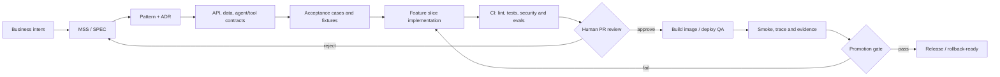

# Assisted Agentic SDLC — Minimal Deployable PA-SDD Pattern v1.0

Status: **reusable design pattern**, not a deployed autonomous software factory. Fits software products, including products that optionally contain ADK/LLM features.

## Non-negotiable distinction
**Build-time agents** collaborate on software delivery (requirements, architecture, code, QA, DevOps). **Runtime agents** are optional product features governed by their own contracts. A product is not made agentic simply by using assistants to write code.

## Engineering flow and evidence gates

**G0 Intent:** measurable result, owner, scope and excluded behaviors. **G1 Design:** sufficient SPEC, contracts, risk and decision record. **G2 Implementation:** one testable vertical slice, no secrets in git. **G3 Assurance:** CI green, negative-path security tests and LLM golden evals if agentic. **G4 Deployment:** pinned image, dedicated identity, live smoke test, logs, rollback instructions and user approval. **G5 Operations:** incident handling, telemetry, cost, reevaluation.

## Minimal roles — NOT independent services
- **Coordinator/Master:** reads SPEC, sequences tasks, collects evidence, never self-approves.
- **SDD analyst:** owns traceability of requirements, acceptance tests, and change log.
- **Architect:** recommends pattern, Mermaid/C4 diagrams and ADRs; no infrastructure action.
- **Builder:** produces narrowly scoped code/test changes in PR; no production credentials.
- **QA & security:** evaluates tests, errors and authorization, records failures.
- **Release/DevOps:** proposes Docker/IaC/CI and release evidence, requires approval before merge/deploy.
Each role is a capability/skill that can be run manually or by ADK; multi-agent runtime and A2A are optional, not prerequisites.

## Artifacts
`AGENTS.md` (local agent instructions), `specs/SPEC.md` (truth), `specs/openapi.yaml`, `db/schema.sql`, `docs/ADR.md`, `tests/acceptance.feature`, `agents/contracts/*.yaml`, `policies/assisted-sdlc.yaml`, `.github/workflows/ci.yml`, `infra/`, `docs/RELEASE_CHECKLIST.md`, `evidence/`.

## Safe authority
PR, merge, deploy and external spending are **human-approved actions**. An LLM can draft commands or code but never grant itself write authority. CI and service-account IAM are enforcement boundaries; plain policy files do not implement authorization. Avoid storing secrets, geolocations or raw prompts in logs. Scope the runtime by least privilege. No automatic production deployment without approved workflow and successful gates.

## Minimum slice definition of done
1. Requirement→US→API/DB→test traceable; tests executed, not merely written.
2. API running with a health endpoint, persistence in a real test environment if required.
3. Docker image builds; CI runs tests with deterministic fixtures.
4. Deploy command is parameterized and reproducible; staging smoke tested with URL/commit recorded.
5. Rollback procedure exists; release approved by a person.
6. For LLM features: tool contract, no unauthorized side effects, golden evals, fallback and spend controls.

## Reference
- [PA-SDD](../progressive-agentic-sdd/README.md)
- [MSS](../../definition-packs/minimum-sufficient-specification.md)
- [GCP implementation profile](../implementation-profiles/gcp/README.md)
- [Governed agentic platform](../pattern-packs/governed-agentic-platform.md)

**Principle:** minimum ceremony, maximum executable evidence. Start with a single feature slice and add ADK specialist execution only when it improves delivery.
